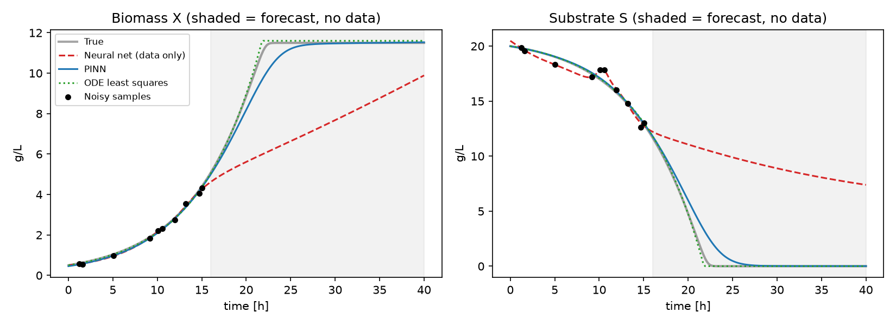

# P1 — Physics-informed neural network for fermentation kinetics

**Question.** Suppose we have only 10 noisy measurements from the first 40% of a
batch fermentation. Can a neural network forecast the rest of the run if it is
told the kinetics, a Monod ODE? And can it recover the kinetic parameters?

> Synthetic data. Trajectories are simulated from a known Monod model, with
> multiplicative Gaussian noise. This was built in November 2026, with AI
> assistance, as preparation for a PhD application.

## Model

Batch Monod kinetics, with biomass *X* and substrate *S*:

```
dX/dt =  μ(S)·X           μ(S) = μ_max · S / (K_s + S)
dS/dt = −μ(S)·X / Y
```

True parameters: μ_max = 0.15 h⁻¹, K_s = 0.6 g/L, Y = 0.55. Initial state X₀ = 0.5 g/L, S₀ = 20 g/L, over a 40 h horizon.
There are 10 observations at random times between 1 and 16 h. The task is to forecast 16–40 h, where there is no data.

| Method | What it is |
|---|---|
| Neural net (data only) | MLP t → (X, S), fitted to the 10 points |
| **PINN** | Same MLP plus the ODE residual on 400 collocation points over 0–40 h, an initial-condition penalty, and learnable log μ_max, log K_s, log Y |
| ODE least squares | Classical approach: integrate the ODE and fit its 3 parameters with `scipy.optimize.least_squares` |

There are 3 noise levels (2%, 5%, 10%) × 3 seeds.

## Results

Biomass forecast RMSE over the unobserved 16–40 h window (g/L, mean of 3 seeds; biomass peaks at about 11.5 g/L):

| Noise | NN (data only) | **PINN** | ODE least squares |
|---|---|---|---|
| 2% | 7.21 | **1.13** | 0.31 |
| 5% | 7.81 | **1.32** | 0.68 |
| 10% | 7.97 | **1.53** | 1.23 |

Parameter recovery (mean relative error):

| Noise | PINN μ_max / K_s / Y | Least squares μ_max / K_s / Y |
|---|---|---|
| 2% | 16% / 677% / 9% | 3% / 92% / 3% |
| 5% | 24% / 843% / 11% | 4% / 100% / 7% |
| 10% | 32% / 899% / 14% | 5% / 100% / 13% |



## What the results show

1. **Physics makes extrapolation possible.** The data-only network fits the 10 points and then extrapolates nonsense. Its error is 5–7× the PINN's, and it varies a lot from seed to seed. The ODE residual constrains the trajectory where there is no data, so the PINN correctly predicts substrate exhaustion and the plateau in biomass.
2. **When the model is exactly right, classical fitting wins.** Least squares on the true ODE structure is the most accurate. That's expected, because it has 3 free parameters against the PINN's thousands. The gap narrows as noise grows. A PINN is worth it when the mechanistic model is only partly known (a hybrid model) or when there are several data sources. It is not a replacement for curve fitting on a known ODE.
3. **K_s is not identifiable from this data, and neither method recovers it.** Over 1–16 h the substrate stays at 12–20 g/L, far above K_s, so μ(S) ≈ μ_max and the data contain almost no information about K_s. Least squares pushes K_s to its lower bound. The PINN overshoots it and raises μ_max to compensate. The two errors cancel in the growth rate actually observed: μ_max·S/(K_s+S) ≈ 0.145 h⁻¹ in both cases at S ≈ 15. This is a **practical identifiability** problem. Before trusting a fitted mechanistic parameter, check whether the experimental design can determine it at all, for example with a profile likelihood or the Fisher information.

## Debugging note: PINN collapse

The first version switched on the physics loss from step 0. It **collapsed in every run** to X(t) ≈ 0. That is a trivial solution: it satisfies dX/dt = μX for any μ, and the kinetic parameters never moved from their initial guesses. The cause was that the physics residual, scaled by the time horizon, swamped the data loss.

The fix was a curriculum. The network fits only the data for 1,500 steps, then the physics weight ramps linearly up to λ over the next 1,500 steps. A one-case sweep ([`results/lambda_sensitivity.md`](results/lambda_sensitivity.md), [`lambda_sweep.py`](lambda_sweep.py)) shows that λ = 0.1 works best. At λ = 1 the run collapses again, and at λ = 0.001 the physics is too weak to help. Balancing the loss terms is the main practical difficulty with PINNs. Adaptive weighting schemes, such as NTK- or gradient-norm-based ones, are the principled fix.

## Limitations and next steps

- Batch Monod is the simplest possible model. Real fermentations have product inhibition, oxygen limitation, temperature dependence and population heterogeneity, such as the C-variant in P2 and P3.
- λ was chosen on a single case. A proper study would use adaptive weighting, or select λ on held-out data.
- The next step is a **hybrid model**: keep mass balances as hard physics and learn the unknown specific growth rate μ(S, T, O₂, …) with a network. That's the approach in the accompanying research proposal.

## Run

Python 3.12, CPU only.

```bash
pip install -r requirements.txt
python pinn.py          # about 15 min on a CPU (single-threaded on purpose)
python lambda_sweep.py  # optional λ sensitivity check
```

## Part of a four-project series

These four projects share one simulated fermentation process: a chemostat with a colonial C-variant, plant drift, and sensor, micrograph and proteomics data. Each project's results motivate the next, and together they point towards hybrid mechanistic–ML models. References to P1–P4 in this README mean:

| | Project |
|---|---|
| P1 | [Physics-informed neural network for fermentation kinetics](https://github.com/GHUSER/pinn-fermentation-kinetics) (this repository) |
| P2 | [Early quality prediction with conformal intervals](https://github.com/GHUSER/fermentation-quality-forecasting) |
| P3 | [Multimodal cross-attention for C-variant detection](https://github.com/GHUSER/multimodal-cvariant-detection) |
| P4 | [Morphology CNN with Grad-CAM](https://github.com/GHUSER/hyphal-morphology-cnn-gradcam) |
